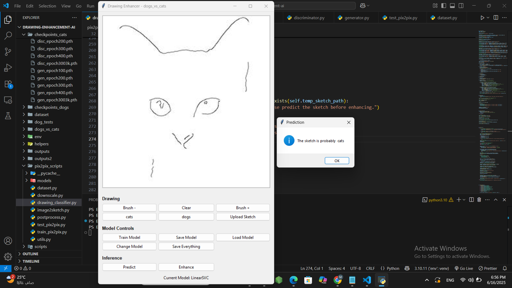
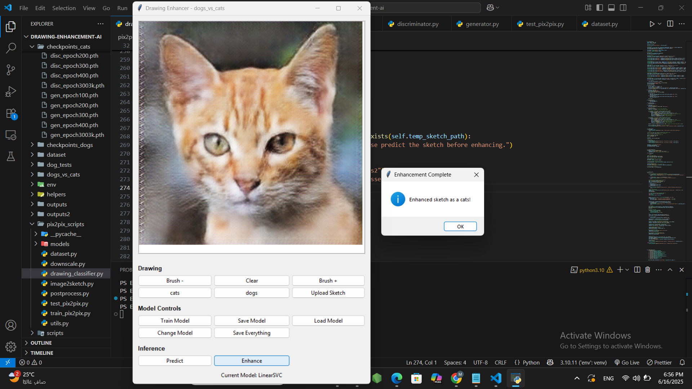
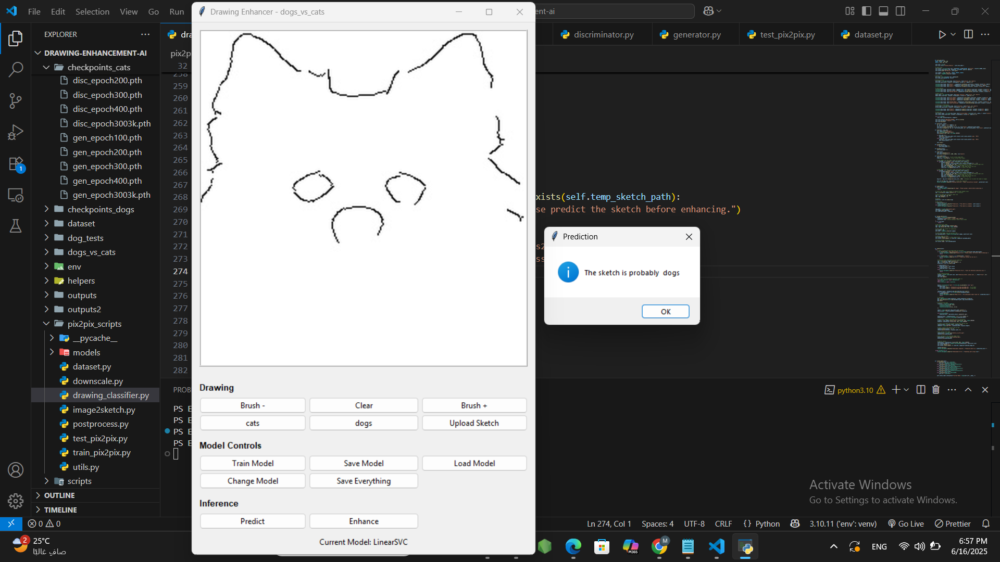
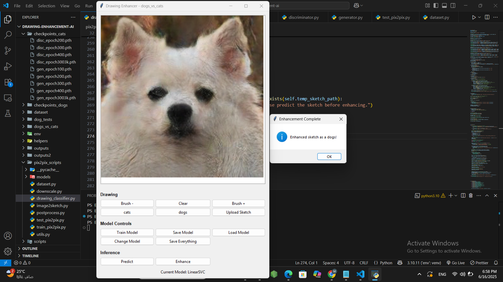

# Drawing Enhancement with AI

Bachelor's graduation project by Mina Remon, Computer Engineering, German University in Cairo.

This project explores sketch enhancement for cats and dogs using a Pix2Pix-style conditional GAN. It also includes a Tkinter drawing and classification interface, an SVM-based classifier, OpenCV preprocessing utilities, and a separate fuzzy-logic sketch analysis experiment.

> **Reproducibility note:** The public repository does not include the pretrained checkpoints or full training datasets. The small `samples/` directory provides ready-to-upload example sketches; inference also requires both pretrained checkpoints described in [Models and checkpoints](#models-and-checkpoints).

## Project overview

The repository has three related parts:

1. The interactive GUI in `pix2pix_scripts/drawing_classifier.py` lets a user draw or upload a sketch, run a classical classifier, and request enhancement.
2. The Pix2Pix implementation in `pix2pix_scripts/` contains the U-Net generator, PatchGAN discriminator, paired dataset loader, training loop, and a standalone inference script.
3. The fuzzy analysis utilities in `scripts/` and `helpers/` estimate contour thickness and complexity, then map those values to an enhancement strength. This is a separate experiment, not a stage in the GAN GUI pipeline.

## Visual Demonstration

The screenshots below are original application captures from the cat and dog workflows. Each before image shows the sketch in the GUI after prediction; each after image shows the generated animal result after enhancement.

### Cat enhancement

| Original sketch | Enhanced result |
| --- | --- |
| <br>Cat sketch with the GUI prediction **cats**. | <br>Generated cat image shown after enhancement completes. |

### Dog enhancement

| Original sketch | Enhanced result |
| --- | --- |
| <br>Dog sketch with the GUI prediction **dogs**. | <br>Generated dog image shown after enhancement completes. |

## Key features

- Tkinter interface for drawing, uploading, saving examples, classifier training, prediction, and enhancement.
- Linear SVM default classifier, with options to switch among several scikit-learn estimators.
- Conditional image translation from one-channel grayscale input to three-channel RGB output.
- Separate cat and dog generator checkpoints selected by the GUI.
- OpenCV Canny preprocessing and fuzzy-logic contour analysis utilities.

## Technologies

Python, PyTorch, TorchVision, OpenCV, Pillow, NumPy, scikit-learn, scikit-image, scikit-fuzzy, Matplotlib, tqdm, and Tkinter (included with many standard Python installations on Windows).

## System architecture

```mermaid
flowchart TD
    A[Draw in GUI or upload PNG/JPG] --> B[Resize uploaded image to 500 x 500]
    B --> C[Save current image as sketch.png when Predict is used]
    C --> D[Resize grayscale image to 50 x 50]
    D --> E[Classifier prediction: class 1 or class 2]
    E --> F[Select cat or dog generator checkpoint]
    F --> G[Grayscale, resize to 256 x 256, normalize to [-1, 1]]
    G --> H[U-Net generator]
    H --> I[RGB enhancement]
    I --> J[Save enhanced.png and before_vs_after.png]
```

The GUI's class-to-checkpoint mapping is positional: the first saved class is mapped to the cat checkpoint, and the second class is mapped to the dog checkpoint. The bundled project data is named `cats` and `dogs`, matching this assumption. The classifier UI's **Predict** button also saves `sketch.png`; **Enhance** requires this prediction step first.

## Repository structure

```text
.
├── Demo/                         # Tracked example sketch images
├── docs/screenshots/             # Original GUI demonstration screenshots
├── samples/                      # Ready-to-use cat/dog input sketches
│   ├── cats/cat-sketch.jpg
│   └── dogs/dog-sketch.jpg
├── helpers/image_utils.py        # OpenCV loading, edges, contours, line measures
├── pix2pix_scripts/
│   ├── models/                   # U-Net generator and PatchGAN discriminator
│   ├── dataset.py                # Paired image Dataset
│   ├── drawing_classifier.py    # Tkinter application entry point
│   ├── image2sketch.py           # Canny-based preprocessing experiment
│   ├── train_pix2pix.py          # GAN training loop
│   └── test_pix2pix.py           # Fixed-path inference example
├── scripts/
│   ├── apply_enhancement.py      # Fuzzy contour enhancement demo
│   ├── fuzzy_enhancer.py         # Fuzzy rules and memberships
│   └── run_fuzzy_test.py         # Fuzzy analysis demo
├── requirements.txt
└── README.md
```

Other local directories include `dataset/` (paired training images), `dogs_vs_cats/` (the larger local image collection), `checkpoints_cats/`, `checkpoints_dogs/` (GAN weights), `cat_tests/`, `dog_tests/`, `outputs/`, and `outputs2/`. The original screenshots at the repository root are preserved; their documented copies live under `docs/screenshots/`.

## Installation and setup

### Prerequisites

- Windows 10/11 or another desktop OS with a working Tk installation for the GUI.
- Python 3.10 or 3.11 is recommended. The repository does not pin or declare a supported Python version; this recommendation is for a modern environment compatible with the listed packages, not a verified project constraint.
- Git and sufficient disk space for PyTorch, datasets, and checkpoints. The two required GUI generator checkpoints alone are about 435 MB; all local cat and dog checkpoint snapshots total about 1.83 GB.
- CPU is supported by the code. CUDA is used automatically when `torch.cuda.is_available()` returns true.

### Clone and create an environment

```powershell
git clone https://github.com/Mina-12/drawing-enhancement-ai.git
cd drawing-enhancement-ai
py -3.10 -m venv .venv
.venv\Scripts\Activate.ps1
python -m pip install --upgrade pip
```

If PowerShell blocks activation, either allow it for the current terminal using your normal Windows policy, or use Command Prompt:

```bat
.venv\Scripts\activate.bat
```

### Install dependencies

Install the project requirements:

```powershell
pip install -r requirements.txt
```

For GPU acceleration, install the PyTorch and TorchVision builds appropriate for the machine from the official [PyTorch installation selector](https://pytorch.org/get-started/locally/). Choose the OS, package manager, Python version, and CUDA build that match the installed NVIDIA driver, then install the selected PyTorch packages in the virtual environment. The repository requirements list `torch` and `torchvision` without CUDA pins. CPU inference is possible, though slower.

## How to run

Run commands from the repository root.

### Interactive drawing and enhancement app

```powershell
python pix2pix_scripts/drawing_classifier.py
```

In the window, click **Upload Sketch** and select a `.png`, `.jpg`, or `.jpeg` image, or draw on the canvas. Click **Predict** to classify the current image and create `sketch.png` in the working directory; then click **Enhance**. The app displays the generated image and saves `enhanced.png` and `before_vs_after.png` in the repository root, overwriting prior files with those names.

The GUI expects these relative checkpoint paths to exist:

- `checkpoints_cats/gen_epoch400.pth`
- `checkpoints_dogs/gen_epoch500.pth`

### Standalone Pix2Pix inference

`pix2pix_scripts/test_pix2pix.py` is a fixed-path example, not a command-line interface. It loads `checkpoints2/gen_epoch100.pth`, reads `cat_tests/test_sketch8.jpg`, and writes `cat_tests/generated.png`. That checkpoint path is distinct from the GUI checkpoints, and `checkpoints2/` is not present in this checkout. Adjusting paths requires editing the script.

### Training

`python pix2pix_scripts/train_pix2pix.py` starts/resumes the training loop using the hard-coded dog pair directories `dataset/raw_sketches/dog` and `dataset/refined_sketches/dog`. It writes generator and discriminator snapshots to `checkpoints2/` and sample outputs to `outputs2/`. It is included for reproducibility and is not needed for inference when the trained GUI checkpoints are available. Training is not required to test the app.

### Fuzzy analysis scripts

`python scripts/run_fuzzy_test.py` and `python scripts/apply_enhancement.py` are fixed-path experiments. They expect test images under `cat_tests/`; the latter opens OpenCV windows and writes `cat_tests/enhanced_test_sketch8.jpg`. These utilities do not load the Pix2Pix checkpoints.

## Recommended input sketches

The `samples/` directory contains one representative cat sketch (`samples/cats/cat-sketch.jpg`) and one representative dog sketch (`samples/dogs/dog-sketch.jpg`). These are ready-to-use test inputs, selected as clear monochrome line sketches with light backgrounds and visible animal outlines. Upload either file through the app's **Upload Sketch** button; the images use formats accepted by the dialog. The samples let an interviewer try both categories without downloading the full `dogs_vs_cats/` collection.

The repository does not record the source or license for these two original images. Confirm that they may be redistributed publicly before publishing the sample copies to GitHub; if permission is unclear, replace them with project-created or appropriately licensed examples.

The larger `dogs_vs_cats/cats/` and `dogs_vs_cats/dogs/` directories contain additional examples in the original local checkout, but are not required for this sample workflow. These preprocessed line-style sketches are more representative of the training input distribution than arbitrary drawings. In the GUI, upload a sample, click **Predict**, confirm the classifier result, then click **Enhance**. The classifier chooses the checkpoint; the GUI has no separate category selector. For the supplied pair, the first class must be `cats` and the second `dogs` to match the GUI's positional checkpoint mapping.

The preprocessing script `pix2pix_scripts/image2sketch.py` converts source images to grayscale, applies a 15×15 Gaussian blur, uses Canny thresholds 80 and 150, and inverts the edge map to produce dark edges on a light background. The generated edge representation and relatively consistent line width/contrast are relevant to the model's learned input distribution.

Manually drawn digital-brush sketches can also be tried, but results may be less consistent when line thickness, detail, contrast, background, or edge character differs from the training examples. This is a generalization limitation of the current model, not necessarily an application execution problem. The current GUI resizes input images and converts them to grayscale for inference; it does not reproduce the Canny edge-extraction procedure automatically. No additional preprocessing is applied to disguise this limitation.

Suggested workflow:

1. Launch the GUI.
2. Click **Upload Sketch** and choose `samples/cats/cat-sketch.jpg` or `samples/dogs/dog-sketch.jpg`.
3. Click **Predict** and confirm the predicted class is the matching animal.
4. Click **Enhance**.
5. Inspect `enhanced.png` and the side-by-side `before_vs_after.png` in the repository root.

Arbitrary manually drawn digital-brush sketches can also be tried, but may produce less consistent results if line thickness, detail, contrast, background, or edge characteristics differ from the training distribution. This is a limitation of the model's generalization, not necessarily an application execution problem; manually drawn sketches are not categorically unsupported.

## Example results

See [Visual Demonstration](#visual-demonstration) for original GUI screenshots. The app saves runtime outputs as `enhanced.png` and `before_vs_after.png` in the repository root. No performance metrics are reported by the implementation.

## Model architecture

`UNetGenerator` in `pix2pix_scripts/models/generator.py` uses eight strided convolutional encoder blocks, seven transposed-convolution decoder blocks, skip connections, BatchNorm, LeakyReLU/ReLU, dropout in the first three decoder blocks, and a Tanh output. It maps a one-channel 256×256 input to a three-channel output.

`PatchDiscriminator` in `pix2pix_scripts/models/discriminator.py` concatenates the one-channel sketch with the three-channel target/generated image and predicts patch-wise real/fake logits. Training uses `BCEWithLogitsLoss` for the adversarial objective and L1 reconstruction loss weighted by 100. Adam uses learning rate `2e-4` and betas `(0.5, 0.999)`.

## Training configuration

The current training script sets image size 256, batch size 4, learning rate `2e-4`, and 100 epochs. It saves generator and discriminator weights at the end of every epoch. Its configured dataset is the dog pair (`dataset/raw_sketches/dog` and `dataset/refined_sketches/dog`). The dataset class pairs sorted filenames by index and uses the shorter folder length; it does not validate that paired names correspond. The script's comments mention a resume path under `checkpoints2/`, but `start_epoch` defaults to zero and each run uses its hard-coded configuration.

## Dataset information

The loader expects paired folders such as:

```text
dataset/
├── raw_sketches/dog/
└── refined_sketches/dog/
```

Images are paired by sorted filename position. The local `dataset/` and `dogs_vs_cats/` directories are not tracked by Git, and no download instructions, provenance, or licensing information are present. To reproduce training or test the recommended local sample workflow from a clean clone, obtain the corresponding data separately and place it at the documented paths. Before redistribution, establish the source and license for all image data.

## Models and checkpoints

Inference requires **both** pretrained generator checkpoints below because the GUI selects the cat or dog generator based on the classifier result. Together, the files are approximately 435 MB. They are not included in the public repository and can be provided upon request.

| Purpose | Required file |
| --- | --- |
| Cat GUI inference | `checkpoints_cats/gen_epoch400.pth` |
| Dog GUI inference | `checkpoints_dogs/gen_epoch500.pth` |

The local folders also contain earlier generator snapshots and discriminator weights (16 checkpoint files, about 1.83 GB total); these are not needed for GUI inference. The GUI only loads the two generator files listed above. The standalone inference script expects a separate `checkpoints2/gen_epoch100.pth` file.

To run inference, obtain both checkpoint files from the project author and place them at the exact paths listed above. A clean clone without these weights cannot run enhancement inference.

## Known limitations

- GUI and standalone scripts use hard-coded relative paths; launch from the repository root.
- The GUI requires both cat/dog generator checkpoints, which are not included in the public repository and can be provided upon request.
- The classifier project metadata (`dogs_vs_cats/dogs_vs_cats_data.pickle`) is not present in the current local sample folders; on first run the GUI asks for class names and initializes a new classifier. The classifier training method looks for `.jpg` files, while examples are saved as `.png`; use the existing saved classifier data when available or treat classifier training as experimental.
- The GUI maps its first class to the cat model and second class to the dog model. Use `cats` then `dogs` when initializing classes for that mapping.
- The GUI's relative import `from models.generator import UNetGenerator` is resolved from Python's import path. On a standard invocation from the repository root, `pix2pix_scripts/models` is not necessarily on that path; if the app reports `No module named 'models'`, run `python` with `pix2pix_scripts` on `PYTHONPATH` as shown in Troubleshooting.
- The training script is configured for dog data only and requires the ignored dataset files.
- Fuzzy scripts use fixed sample paths and are separate from GAN enhancement.
- No automated tests, pinned dependency versions, dataset provenance, or model download manifest are included.

## Troubleshooting

**`No module named 'models'` when starting the GUI**

From the repository root in PowerShell:

```powershell
$env:PYTHONPATH = (Join-Path (Get-Location) 'pix2pix_scripts')
python pix2pix_scripts/drawing_classifier.py
```

The source uses a top-level `models` import. This command makes the existing model package discoverable without changing model code.

**Missing checkpoint / “No enhancement model found”**

Confirm the exact cat and dog generator files listed above exist under the repository root. They are not included in the public repository; request both pretrained checkpoints from the project author.

**Missing image or dataset path**

Run scripts from the repository root and confirm the fixed relative paths in the relevant section exist. Datasets and test images are ignored and are not included in a fresh clone.

**Tkinter cannot open a window**

Use a desktop Python installation with Tk support, not a headless environment. On Windows, install Python from python.org with the Tcl/Tk component enabled.

**CUDA unavailable or out of memory**

The scripts fall back to CPU when CUDA is unavailable. For GPU use, install a compatible PyTorch build using the official selector. For limited GPU memory, inference on CPU may work more slowly; the training batch size is fixed at four in the training script.

**PowerShell does not allow virtual environment activation**

Use Command Prompt activation (`.venv\Scripts\activate.bat`) or follow your organization’s PowerShell execution policy for local scripts.

## License

No license file is present. Confirm project and dataset licensing before redistribution.
